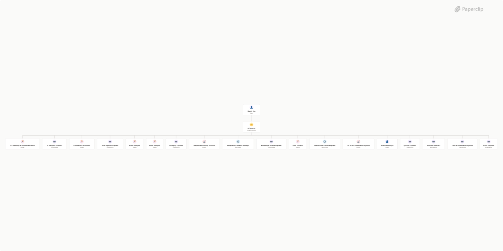

# Sketch Dev



## What's Inside

> This is an [Agent Company](https://agentcompanies.io) package from [Paperclip](https://paperclip.ing)

| Content | Count |
|---------|-------|
| Agents | 20 |

### Agents

| Agent | Role | Reports To |
|-------|------|------------|
| 3D Modeling & Environment Artist | designer | ai-director |
| AI Director | CEO | sketch-dev |
| AI & Physics Engineer | Engineer | ai-director |
| Animation & VFX Artist | designer | ai-director |
| Asset Pipeline Engineer | Engineer | ai-director |
| Audio Designer | designer | ai-director |
| Game Designer | designer | ai-director |
| Gameplay Engineer | Engineer | ai-director |
| Independent Quality Reviewer | qa | ai-director |
| Integration & Release Manager | devops | ai-director |
| Knowledge & Skills Engineer | Engineer | ai-director |
| Level Designer | designer | ai-director |
| Performance & Build Engineer | devops | ai-director |
| QA & Test Automation Engineer | qa | ai-director |
| Reference Analyst | researcher | ai-director |
| Sketch Dev | general | — |
| Systems Engineer | Engineer | ai-director |
| Technical Architect | Engineer | ai-director |
| Tools & Automation Engineer | Engineer | ai-director |
| UI/UX Engineer | Engineer | ai-director |

## Getting Started

```bash
npx paperclipai company import this-github-url-or-folder
```

See [Paperclip](https://paperclip.ing) for more information.

---
Exported from [Paperclip](https://paperclip.ing) on 2026-10-19
